<h1></h1>

[Search the glossary](https://htmlpreview.github.io/?https://raw.githubusercontent.com/pedramgoshATgmail/EVALATHAN/main/docs/glossary.html). That page is the glossary, with its lettering and images, and the search slot is on the same page. Type a letter and the matching entries appear. Choosing a word moves to that entry.

Evalathan is one evaluation harness. Hydra is the conductor. She governs and calls sixteen evaluators, short name evalers. Each entry below has the same three parts.

 What is counted, whether that count is a yes-or-no pass, and the three endings a cell can have. Measured means the file or the code was there and a result was written. Claim means a sentence is on disk and this run did not re-check it. Blank means the needed record is missing. A blank is not a fail and not a zero.

 Explanations in simple terms.

 More technically detailed explanations.

The life-cycle gate on each evaler (G0 through G12) is the station's place in the life of a product. There are not sixteen gates. There are sixteen evalers.

<h2></h2>

<h3></h3>

Scans root and documentation directories for dedicated architectural manifests (e.g., ARCHITECTURE.md, /docs/architecture, C4 models, or ADR logs). Returns Pass if an architectural document exists, Fail if absent, and Deferred if docs are unparsable. It does not grade whether the architecture itself is optimal.

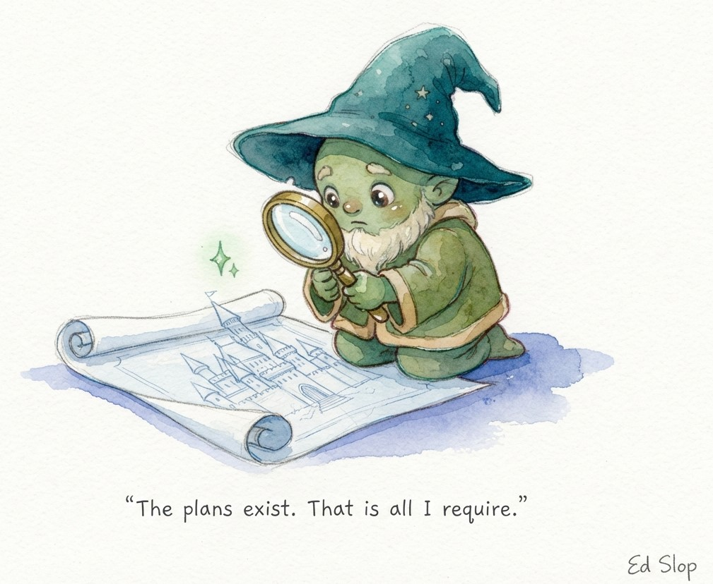

<h3></h3>

Before you buy a house, you check if blueprints exist. Archly checks if the software comes with a clear structural plan or if it was built blindly on the fly.

<h3></h3>

The public contents of the 97 principles are listed at [97 Things Every Software Architect Should Know](https://yoshi389111.github.io/kinokobooks/soft_en/index.html). MoE means that panel of expert authors, more than 50 of them. Their published lessons are the checklist. They do not log in and score the repository.

The scan reads the README and markdown under `docs`, `doc`, `architecture`, or `adr`. A principle is scored only when a file in this tree is evidence for it: 4 Strong when a document and a matching artifact both cite it, 3 Solid when one of those is present, 2 Emerging when only the README mentions it. A principle with no evidence stays deferred and is not entered as zero. The mean is the mean of the scored principles. It is not a pass. The international description of an architecture review is [ISO/IEC/IEEE 42030](https://www.iso.org/standard/73436.html). Archly does not issue that certificate. The same evidence rule scores five institutional standards beside the 97, and their mean is not folded into the 97 mean: [NASA Technology Readiness Level](https://www.nasa.gov/directorates/somd/space-communications-navigation-program/technology-readiness-level/), [ISO/IEC 25010](https://www.iso.org/standard/78176.html), ISO/IEC/IEEE 42030, [SEI ATAM](https://en.wikipedia.org/wiki/Architecture_tradeoff_analysis_method), and [AWS Well-Architected](https://aws.amazon.com/architecture/well-architected/).

<h2></h2>

<h3></h3>

Parses agent orchestrator configurations (e.g., YAML/JSON agent rosters) to tally registered agent identities, designated system prompts, and tool authorizations. Identifies unassigned workers or overlapping, ambiguous responsibilities.

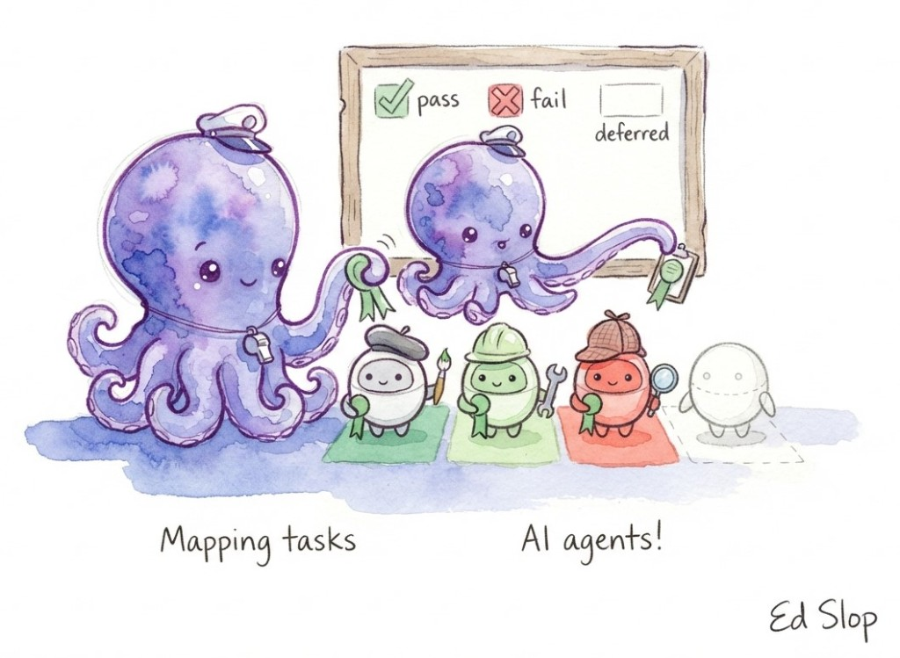

<h3></h3>

The organizational chart for an AI bot team. It ensures every digital worker has a specific job title, defined tools, and clear duties so they don't trip over each other while working.

<h3></h3>

Roster files are `agent_registry.md`, `agents.md`, `agentic_registry.md`, or any markdown file inside a folder named `agents`. Rows that start with a bold table cell are counted. SASPIANT (Specific and Specialized, Pain-In-the-Ass, Non-critical Tasks) is the question the roster is for: is this a narrow chore, or a person-shaped decision. Chorely counts. It does not answer that question for you.

<h2></h2>

<h3></h3>

Parses supported Abstract Syntax Trees (ASTs) to compute cyclomatic and decision complexity points (counting if, elif, switch/match, for, while branches). Files in unsupported languages remain Blank/Deferred (which does not count as a pass or zero).

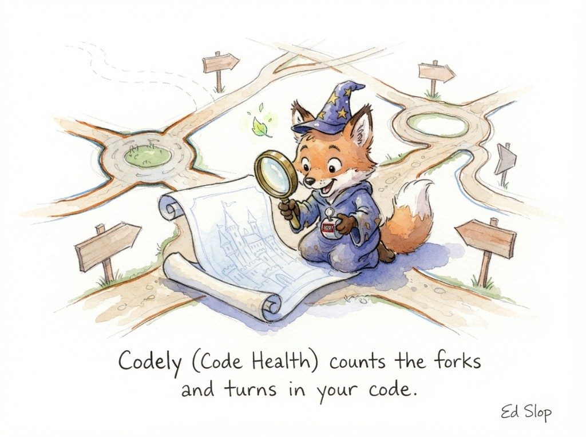

<h3></h3>

Like counting how many forks, roundabouts, and blind turns are on a road. Fewer turns make driving smooth; too many forks mean drivers (and programmers) are prone to getting lost or crashing.

<h3></h3>

The Python pack walks the syntax tree and counts `if`, `for`, `while`, `except`, `with`, and `assert` nodes inside functions. Named packs that are not executed in this version: JavaScript, TypeScript, C, C++, Rust, Go, and Java. An unknown suffix is a blank whose summary says it is not a pass. pytest, coverage, radon, and ISO/IEC 5055 are not launched. [ISO/IEC 5055](https://www.iso.org/standard/80623.html) is automated source-code quality measures. A radon run is not a 5055 result, and this scanner does not produce one.

<h2></h2>

<h3></h3>

Scans the repository's .git tree. Counts total historical commits, change intervals, and branch merges. Requires a valid local git history; repositories without git metadata return a Deferred status. This is an objective measurement of repository activity, not an assessment of developer ability or code quality.

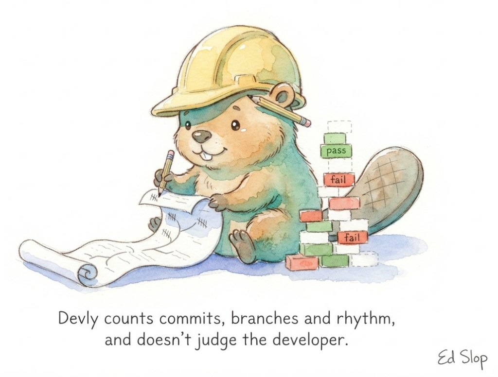

<h3></h3>

Think of it like a construction site logbook. It doesn't judge whether the architect is a genius; it simply verifies that workers have consistently shown up and laid bricks on the schedule they claim.

<h3></h3>

The scan runs `git rev-list --count HEAD` when a `.git` folder is present and writes that integer. `passed` stays empty. If there is no git history, the cell is blank. Skills Framework for the Information Age (SFIA, a job-skill scale for technology work) is named so that nobody reads a level into the commit count. Devly does not award an SFIA level. The public framework is at [sfia-online.org](https://sfia-online.org/en/about-sfia).

<h2></h2>

<h3></h3>

Evaluates project-supplied question-and-answer manifests. Computes the coverage ratio and exact match/similarity score against a validated golden dataset. Distinct from generic unit tests - focuses on domain/subject-matter accuracy.

<h3></h3>

A subject-matter final exam. It tests how well your application answers specialized, real-world industry questions against an official answer key.

<h3></h3>

JSON or YAML files whose names contain `question` or `answer` are read. Questions are counted. Answers are matched by `id` when an answers file exists. `passed` stays empty. Runly and Codely remain the stations for a language conformance suite.

<h2></h2>

<h3></h3>

Scans for structured usability audit records, heuristic evaluations, or accessibility scorecards (e.g., WCAG compliance logs, UX benchmark JSONs). Marketing sentences or vague promises of "great UX" in a README yield no score.

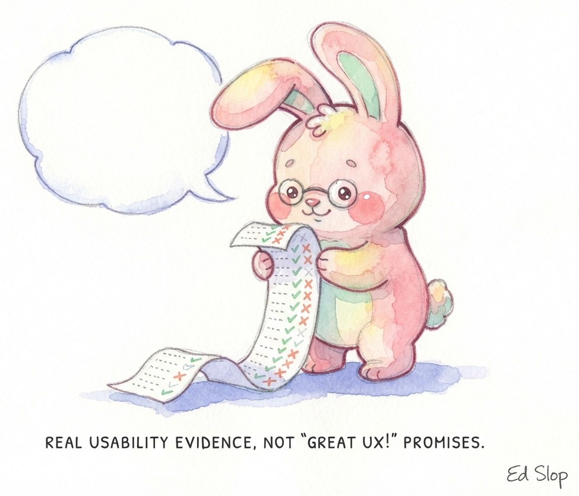

<h3></h3>

Customer reviews backed by verifiable receipts. Instead of taking the developer's word that their app is "intuitive and user-friendly," Levi checks for actual recorded usability testing.

<h3></h3>

The file must be JSON whose family or brand contains `4uval`, with a `gate` object. The summary prints `gate.mean` and `gate.result`. [4Uvals](#user-content-4uvals) (Ultimate User-User-User evaluations) is the ten-check user-first scorecard, defined at that entry. [ISO/IEC 42001](https://www.iso.org/standard/81230.html) is an AI management system for a firm. Levi names it as a wrapper beside the sitting. It is not the grade. Levi prints the mean and the gate that are already on the card. It does not rescore the ten checks.

<h2></h2>

<h3></h3>

Inspects client-facing components for actual code-level pacing controls, break intervals, or integrated session switches (such as the repository's fuss/ module). General wellness advice written in markdown does not count as an implementation.

<h3></h3>

Checking if a car comes equipped with working seatbelts and speed limit warnings. It makes sure the software contains real code that encourages healthy work breaks, rather than quietly enabling non-stop screen addiction.

<h3></h3>

A Python function named `bind_fuss` or `bindfuss`, or an assignment to `session_limit_minutes`, is a timer. In JavaScript, `function bindFuss` is a timer, including the copy in [fuss/fuss.js](fuss/fuss.js). A file whose name is `fuss` is a timer. The provisional phrases are "take a break", "session limit", and "time budget". The bare word fuss is not enough. FUSS (For-User Session Switch) is the drop-in panel in [fuss/README.md](fuss/README.md). This is not a medical device and not an ISO certificate.

<h2></h2>

<h3></h3>

Scans the project tree, aggregates Source Lines of Code (SLOC) by file extension, and calculates the exact percentage distribution across languages while ignoring third-party vendor directories (e.g., node_modules/, site-packages/). Reports pure data without prescribing stack changes.

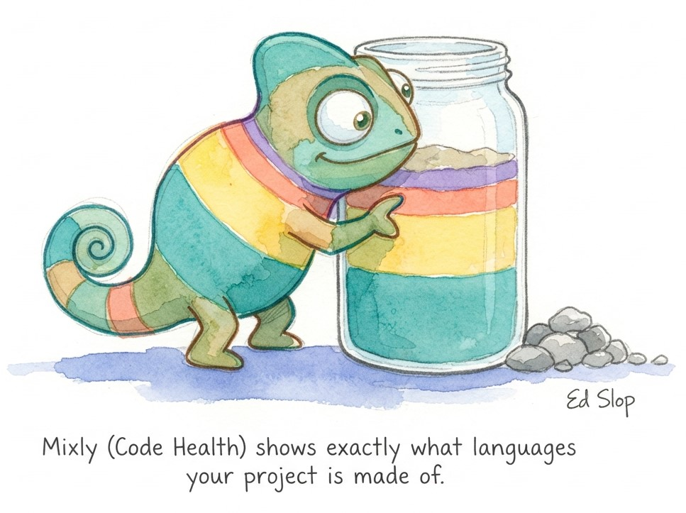

<h3></h3>

The ingredients label on a cereal box. It tells you exactly what percentage is wheat, corn, or sugar so you know what you are consuming before you take a bite.

<h3></h3>

Suffixes map to a language name: Python, JavaScript, TypeScript, C, C++, Rust, Go, Java, Kotlin, Ruby, PHP, C#, Swift, MEL, and VEX. The summary is a percentage of recognized files. Mixly does not parse those files and does not rank the languages.

<h2></h2>

<h3></h3>

Extracts metrics from existing compression logs, specifically recording raw byte reduction alongside objective image/video quality scores (e.g., SSIM, PSNR, VMAF, or CRF values). Pressly does not execute the compression pipelines during the evaluation scan.

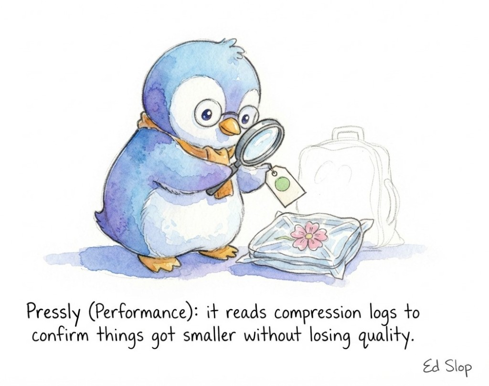

<h3></h3>

Inspecting a vacuum-sealed suitcase. Pressly checks the luggage tag to confirm you actually shrank the package down to carry-on size without crushing the fragile items inside.

<h3></h3>

Logs, text, JSON, and markdown are scanned for `ssim`, `vmaf`, or `bytes`/`size` followed by a colon or an equals sign and a number. SSIM (structural similarity, a picture-likeness score) is described at [Wikipedia](https://en.wikipedia.org/wiki/Structural_similarity). VMAF (Video Multi-Method Assessment Fusion, Netflix's video-quality score) is at [Netflix/vmaf](https://github.com/Netflix/vmaf). A match is reported as a printed figure. It is not a TOKEX result.

<h2></h2>

<h3></h3>

Analyzes token-similarity and line duplication across files, cross-references internal function/class call graphs for orphaned/dead declarations, and tallies git change frequency per file. Flags files with high churn-to-complexity ratios as refactoring liabilities.

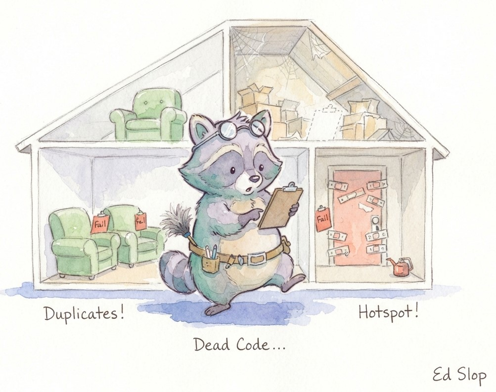

<h3></h3>

An inspector checking your house for duplicate furniture you bought twice, abandoned rooms in the attic that nobody uses, and a back door that squeaks so badly it needs weekly repairs.

<h3></h3>

Identical-byte groups are SHA-256 matches among files between 1 and 200,000 bytes. Unused names are Python functions and classes that are defined and never referenced, skipping names that start with `_` or `test`. Change is `git log --numstat` over the last 40 commits when git exists. The unused-name walk is the one language-specific check in this version. The copy check and the change check apply to whatever files are in the tree.

<h2></h2>

<h3></h3>

Measures wall-clock execution time for defined micro-benchmark routines or parses valid, pre-computed benchmark artifacts (e.g., pytest-benchmark JSON output). Defers execution if no executable targets or saved logs are present in the target directory.

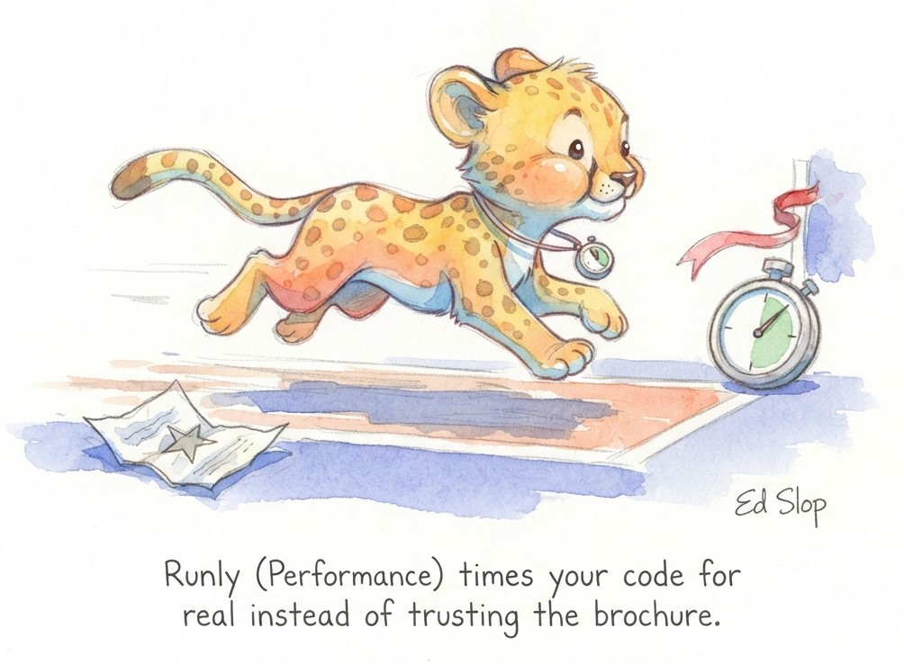

<h3></h3>

A quick 100-meter sprint test. It checks how fast your software actually runs on the track right now, rather than trusting how fast the sales brochure claimed it was.

<h3></h3>

Any tree with Python source gets a local microbench: 200,000 integer steps, reported in milliseconds, labeled as an Evalathan microbench. Files whose names contain `pyperformance`, `spec2017`, or `llvm-test-suite` are noted and not executed. SPEC CPU is the industry suite at [spec.org](https://www.spec.org/cpu2017/). The LLVM test suite is a compiler project, not a file this scanner invents. [ISO/IEC 25010](https://www.iso.org/standard/78176.html) describes product quality, including performance efficiency. Runly does not compute a 25010 score.

<h2></h2>

<h3></h3>

Aggregates findings from the other 15 evaluators into a clean report matrix. Explicitly prohibits flattening heterogeneous measurements into a misleading single 0–100 score. Preserves Pass, Fail, and Deferred states as independent data points.

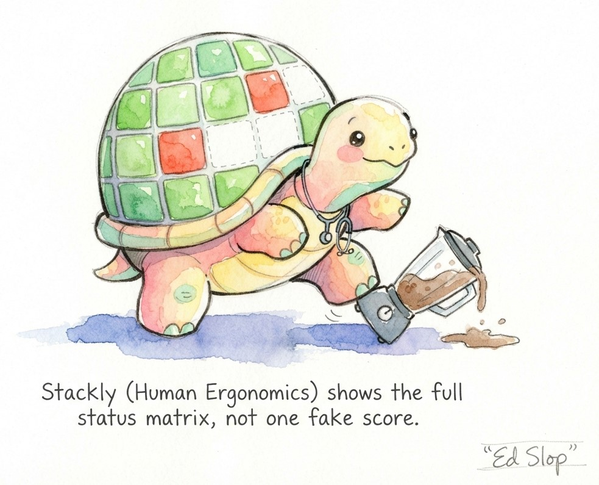

<h3></h3>

A detailed medical blood panel instead of a single 1-to-10 wellness score. It tells you exactly what is healthy, what needs attention, and what wasn't tested, giving you total transparency.

<h3></h3>

`ACCEPTS_PRIOR` is set, so Hydra passes the earlier cells in. `passed` stays empty on purpose. The headline of the report is the same vector: ran, passed, deferred.

<h2></h2>

<h3></h3>

Ingests structured LLM transaction logs containing baseline and optimized token usage pairs. Calculates the net token delta (Tokens before - Tokens after). If token records are not saved in the target path, the cell is marked Deferred rather than zero.

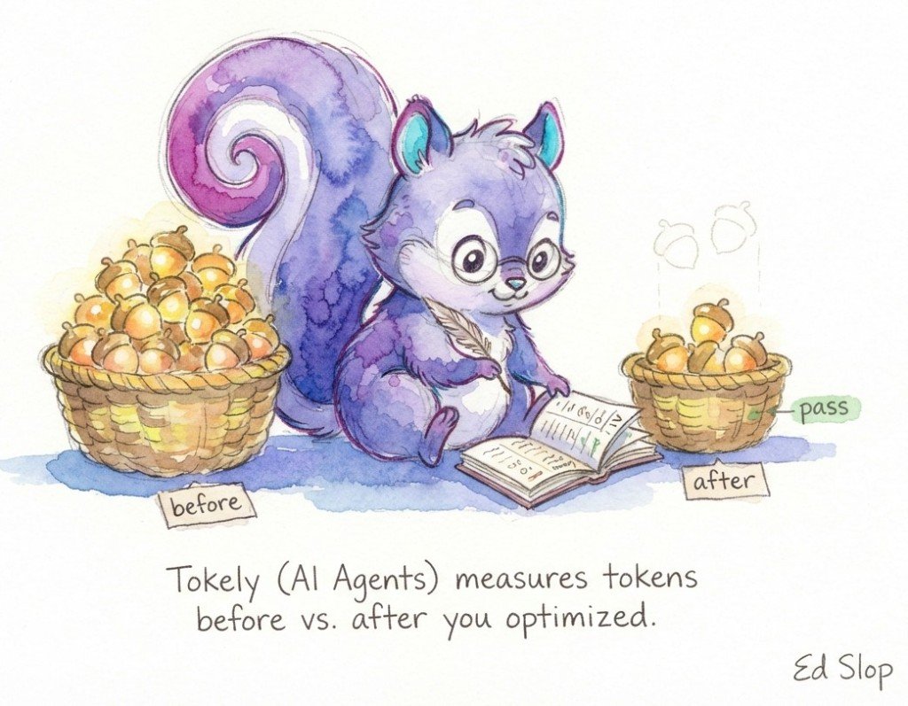

<h3></h3>

A fuel economy tracker for AI apps. It measures how much gas (tokens) your prompts burned before vs. after tuning to make sure you aren't wasting money on bloated queries.

<h3></h3>

JSON may use `before` and `after`, or `total_tokex` and `tokex_this_run`, including those keys inside a `tokex` object. TOKEX (Token Expenditure) is the name of that count. Tokely does not import a tokenizer and does not call a model. Pressly's byte counts are a different measurement.

<h2></h2>

<h3></h3>

Analyzes sequential execution logs of agentic tasks. Counts total steps taken, tool call frequencies, backtracking loops, and final task resolution states. Disregards third-party leaderboard claims that lack inspectable raw trace files.

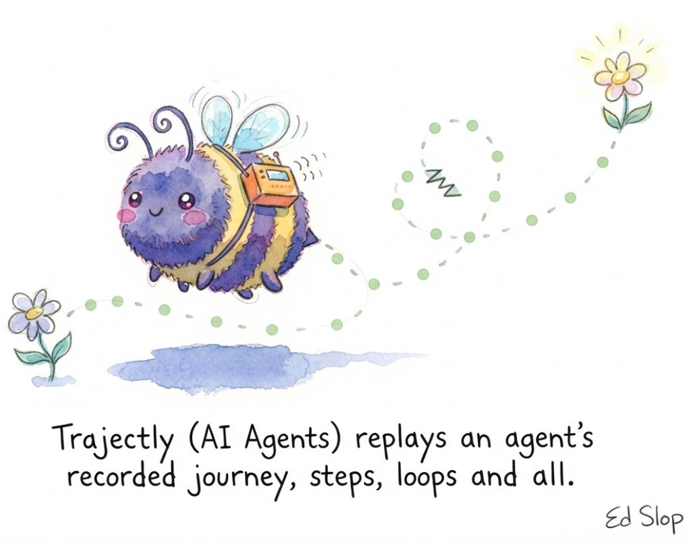

<h3></h3>

The flight data recorder (black box) for an autonomous agent. It tracks every turn the agent took to solve a problem so you can see whether it flew straight to the target or took five dizzying loops.

<h3></h3>

File names containing `trace`, `trajectory`, or `passk` are read. JSONL lines that parse as JSON are counted as steps. Other matching files count as one step. The summary says the count is from files in the tree.

<h2></h2>

<h3></h3>

Validates the presence of an explicit Engineering Priority Triad declaration that orders Cost, Speed/Latency, and Impact. Evaluates whether the team has officially declared which compromise comes first when system constraints collide.

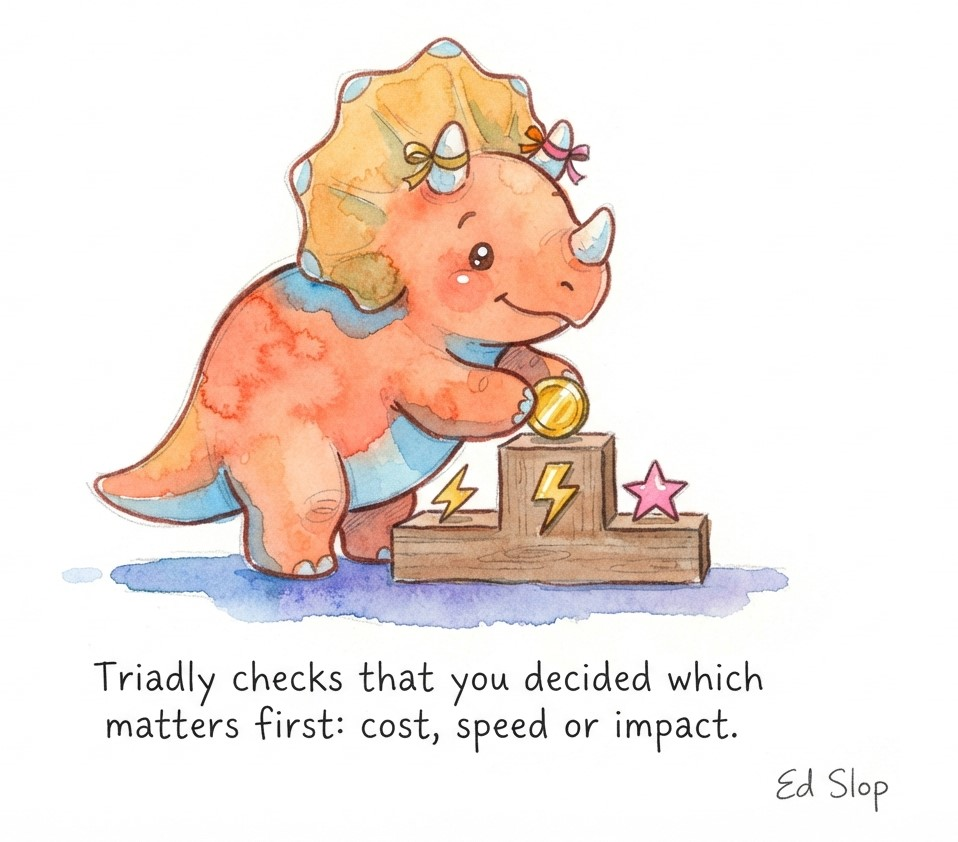

<h3></h3>

The golden rule of any workshop: "Cheap, Fast, or Good - pick two." Triadly verifies that your team explicitly wrote down which one matters most before building the product.

<h3></h3>

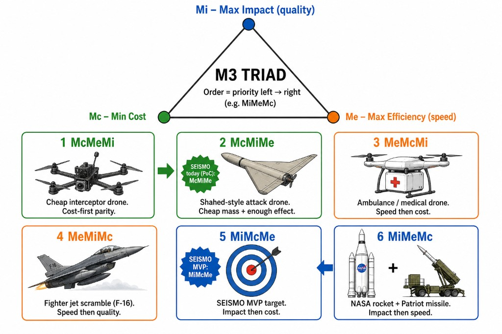

Mc (Min Cost) · Me (Max Efficiency/speed) · Mi (Max Impact/quality); order = priority left-to-right. Six orders: McMeMi cheap interceptor drone; McMiMe Shahed-style (SEISMO PoC today); MeMcMi ambulance drone; MeMiMc fighter scramble; MiMcMe SEISMO MVP target, impact then cost; MiMeMc NASA rocket and Patriot missile, impact then speed.

The accepted compact orders are `mcmemi`, `mcmime`, `memcmi`, `memimc`, `mimcme`, and `mimemc`, read from the README and from markdown, JSON, and text. The scan looks for those codes with spaces removed. It does not treat the word M3, by itself, as an order.

<h2></h2>

<h3></h3>

Cross-references listed performance claims and product assertions against linked source code, test seeds, external dataset URLs, or academic citations. Claims without verifiable backing artifacts fail the check.

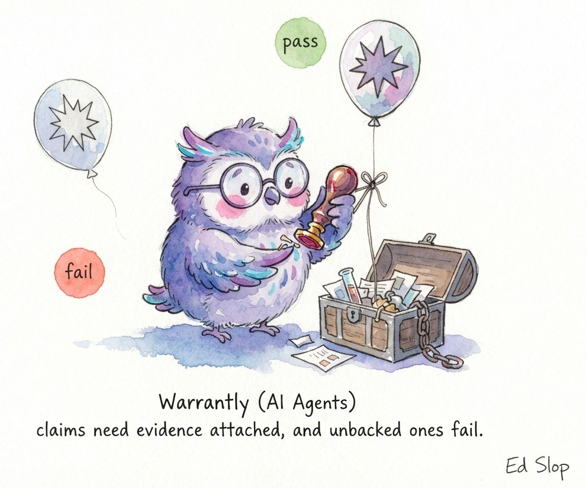

<h3></h3>

The "show your work" math test rule. If your software claims to be 10x faster or 99% accurate, Warrantly checks if you provided the actual proof or just made an empty sales pitch.

<h3></h3>

JSON may be a list of objects with a `claim` key, or an object with `claims` or `warrants`. Backing is any of `source`, `recipe`, or `evidence`. The pass flag is true only when the backed count equals the claim count and the list is not empty.

<h2>4Uvals</h2>

4Uvals (Ultimate User-User-User evaluations) is a 10-check list. The question is whether a session with an AI actually put the person using it first. Levi reads the card when a copy is in the tree. 4Uvals is not a seventeenth evaler.

<h3></h3>

The published card is 4Uvals v1.2. The people who ran the sitting scored it themselves. The gate is PASS. Nine of the ten checks are Solid or Strong. The mean is 3.4 out of 4. Scores use a 1–4 scale: 4 Strong, 3 Solid, 2 Emerging, 1 Weak. U5 is Emerging because it was declared and not measured. That cell stays Emerging. It is not written down as a fail, and it is not written down as zero.

A freeze, the choice to pause the session, is optional on purpose. An adult can leave it off. It is not a lock built for a child.

Sixteen published usability and health standards are housed under the card as comparisons. They are not added into the ten checks, and they are not averaged into the 3.4.

<h3></h3>

4Uvals stands for Ultimate User-User-User evaluations. It asks, in ten plain questions, whether this sitting put the user first. The published answer is a pass: 9 of 10 checks are Solid or Strong, and the average is 3.4 out of 4. One question, about retelling the work, was named and not measured. NASA-TLX (NASA Task Load Index, a short questionnaire for how hard a task felt) on this card is one educated user scoring 9 out of 100, inside the low band of 0–24. That is one person's score. It is not a NASA certificate. The card is not an ISO, IEEE, IEC, W3C, FDA, or NASA certificate.

<h3></h3>

Stamp on the card: 4Uvals v1.2. Ten checks, U1–U10. First-order means the operator scored the sitting. The pass rule used on this card is a mean of at least 3.2 and at least 8 of 10 checks Solid or Strong. This card clears both: mean 3.4, and 9 of 10. [ISO/IEC 42001](https://www.iso.org/standard/81230.html) is named beside the sitting as the firm-level wrapper (U4). It is not the sitting grade.

| ID | Check | Score | Label |
| :--- | :--- | ---: | :--- |
| U1 | Rubric stem | 3 | Solid |
| U2 | Loyalty language | 3 | Solid |
| U3 | Cite the legal gap | 4 | Strong |
| U4 | Outer wrapper, ISO/IEC 42001 | 3 | Solid |
| U5 | Retell, map then measure then manage | 2 | Emerging |
| U6 | FUSS (For-User Session Switch) instrument | 3 | Solid |
| U7 | Preface discipline | 4 | Strong |
| U8 | Honor the person, and keep freeze optional | 4 | Strong |
| U9 | Well-being axis | 4 | Strong |
| U10 | Footnote only, not medical | 4 | Strong |

The housed sixteen are analogs. An analog is a comparison with a published standard. It is not folded into the mean.

| # | Instrument | Analog |
| :--- | :--- | :--- |
| 1 | [ISO 9241-210:2019](https://www.iso.org/standard/77520.html) | 2 Emerging |
| 2 | [ISO 9241-110](https://www.iso.org/standard/75258.html) | 3 Solid |
| 3 | ISO 9241-300 series | 2 Emerging |
| 4 | ISO 9241-400 series | 1 Weak |
| 5 | ISO 10075-1 | 3 Solid |
| 6 | ISO 10075-2 | 2 Emerging |
| 7 | ISO 10075-3 | 1 Weak |
| 8 | [ISO/IEC 25019:2023](https://www.iso.org/standard/78177.html), quality in use | 3 Solid |
| 9 | [IEEE 7010-2020](https://standards.ieee.org/ieee/7010/7718/) | 3 Solid |
| 10 | [WCAG 2.1](https://www.w3.org/TR/WCAG21/) (Web Content Accessibility Guidelines) | 2 Emerging |
| 11 | [WCAG 2.2](https://www.w3.org/TR/WCAG22/) | 2 Emerging |
| 12 | ISO/IEC 40500, the ISO adoption of WCAG | 2 Emerging |
| 13 | IEC 62366-1 | 2 Emerging |
| 14 | [NASA-TLX](https://ergosphere.com.au/tools-nasa-tlx.html), first-order, one person, 9/100 | 3 Solid |
| 15 | SUS (System Usability Scale) and [UEQ+](https://www.ueq-online.org/) (User Experience Questionnaire Plus) | 2 Emerging |
| 16 | CVS-Q (Computer Vision Syndrome Questionnaire) | 1 Weak |

H14 on the card is the NASA-TLX row: one educated user, overall 9 out of 100, low band 0–24. SUS and UEQ+ are named. Their item scores are not on the card, so none are printed here. CVS-Q was not administered. None of these sixteen is a certificate.

<h2></h2>

SELFBELT is the seatbelt write-up for people who sit with software, including AI tools, for a long time. The pages are on [SELFBELT](docs/SELFBELT.md). The practice named inside the document is SELFBELTING. The button name and the page name are SELFBELT.

<h3></h3>

SELFBELT is not one of the sixteen evalers and it does not add a seventeenth score. Menschly is the evaler that can see a timer. The PDF is the explanation a developer can read and, if they choose, ship beside their own software.

<h3></h3>

Think of the early car. Lights, signs, and laws showed up before the seatbelt. A lot of software today has the lights: filters, policies, usage caps written by the vendor. The belt is the habit the person puts on. SELFBELT is that write-up. FUSS is a belt you can clip into a product: a small panel that asks whether to time the sitting.

Ralph Nader's *Unsafe at Any Speed* (1965) pushed crash safety into the car instead of leaving it as optional chrome. The analogy stops there. SELFBELT is not a law, not a medical claim, and not a statement that one sitting harms a brain.

<h3></h3>

Menschly links here. The drop-in timer is [fuss/README.md](fuss/README.md). Installing FUSS is optional. A product can pass Menschly with any real stop, and a product with no sitting stays blank. Nothing in the PDF is scraped into a numeric grade.

<h2>Ed Slop</h2>

'Ed Slop' is an AI nom de plume found at the bottom of some of the art and illustrations in Evalathan glossary. Ed Slop is short for Educational Slop (Generative AI visuals) and it doesn't represent any living or human artist, nor does it support trivial slop. Ed Slop's purpose is illustrative imagery and art to help readers better understand complex topics, all through ethical, nontrivial Generative AI creations.

<h2></h2>

These are public exams for coding agents and for chat models. They matter in this period. Evalathan does not run them in the laptop scan, and it does not paste their leaderboards. That is a scope fact, not a dismissal. Trajectly is the station that will count one of them on the day a saved trace from that exam is in the folder you scan. A percent copied from a website is still not a grade.

<h2></h2>

<h3></h3>

No Evalathan score. The public board is someone else's number. The cell stays off the vector until a trace file from a run is in the tree.

<h3></h3>

SWE-bench (Software Engineering Benchmark) is a set of real GitHub issues a coding agent is asked to patch. The full public set is large and is graded in containers. That does not fit a laptop scan of an ordinary folder. Evalathan can say the name. It does not pretend it sat the exam.

<h3></h3>

The project site is [swebench.com](https://www.swebench.com/). A short public account is on [Wikipedia](https://en.wikipedia.org/wiki/SWE-bench). Trajectly would count a local file whose name contains `trace`, `trajectory`, or `passk`. It will not count a screenshot.

<h2></h2>

<h3></h3>

Same as SWE-bench. Not on the vector. The public slice is still a lab run.

<h3></h3>

SWE-bench Pro is a harder, later set from the same family, with a public slice and private slices. It is the right ambition for a hosted exam on a machine that can run it. It is too much work for the current laptop scan, and a copied percent would not make Evalathan more true.

<h3></h3>

The paper is [arXiv:2509.16941](https://arxiv.org/abs/2509.16941). Inclusion later means a frozen task folder, the grader that ships with it, and a trace Trajectly can count. It does not mean embedding the live leaderboard.

<h2></h2>

<h3></h3>

Not on the vector. No trace, no cell.

<h3></h3>

DeepSWE is a smaller public agent exam, on the order of a hundred handwritten tasks, at deepswe.datacurve.ai. Smaller does not make it a laptop feature. It joins the same menu as the SWE-bench family: host it when the grader and the trace are yours.

<h3></h3>

The public page is [deepswe.datacurve.ai](https://deepswe.datacurve.ai/). Evalathan does not download that board and does not average it with anything else.

<h2></h2>

<h3></h3>

AOSE is a field, not a score Evalathan prints.

<h3></h3>

AOSE (agent-oriented software engineering) is the research tradition of building software as cooperating agents. The Wikipedia page also carries a mixed table of newer benchmarks. Those rows are a catalog. They are not sixteen more evalers, and they are not a grade of the folder you just scanned.

<h3></h3>

The field overview is [Wikipedia: Agent-oriented software engineering](https://en.wikipedia.org/wiki/Agent-oriented_software_engineering). Names that show up in that public catalog, besides the SWE-bench family, include AgentBench, tau-bench, WebArena, WildBench, and Test of Time. Evalathan does not collapse that table into one number.

<h2></h2>

<h3></h3>

Not on the vector. WildBench grades chat replies. It is not a trace of a coding agent unless you saved one.

<h3></h3>

WildBench is a public benchmark of hard chat tasks drawn from real use. It is worth knowing about. Evalathan does not host it and does not quote its board. It would show up under Trajectly only if you saved a run in the folder.

<h3></h3>

The paper is [arXiv:2406.04770](https://arxiv.org/abs/2406.04770). No leaderboard percent from that paper is copied into a cell.
