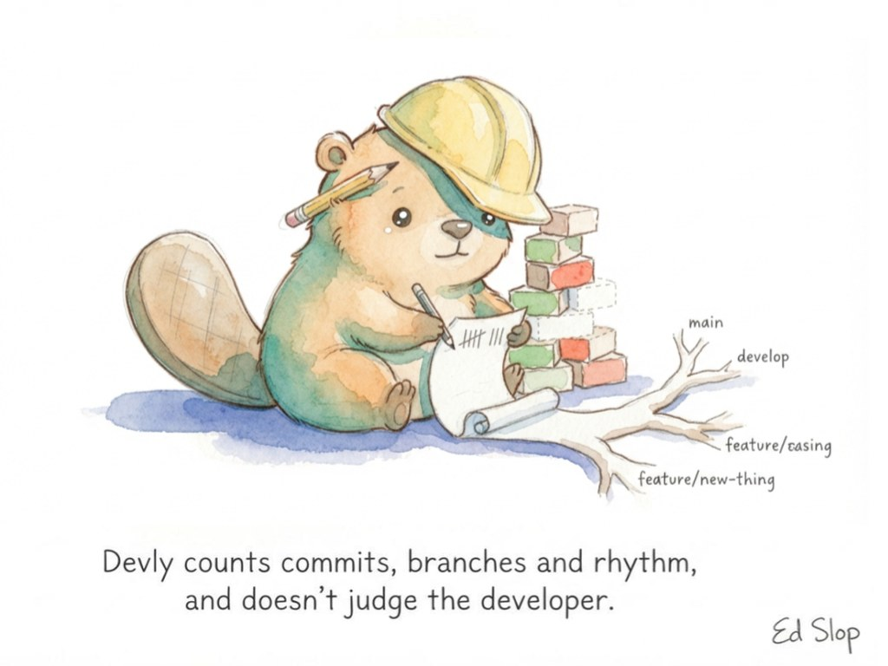
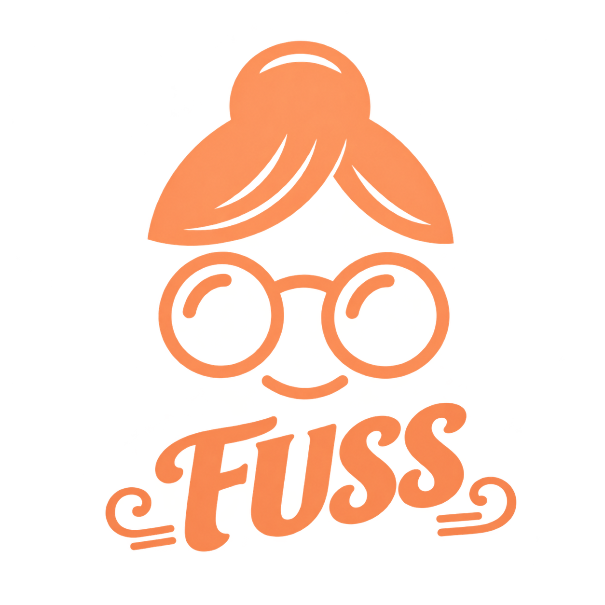
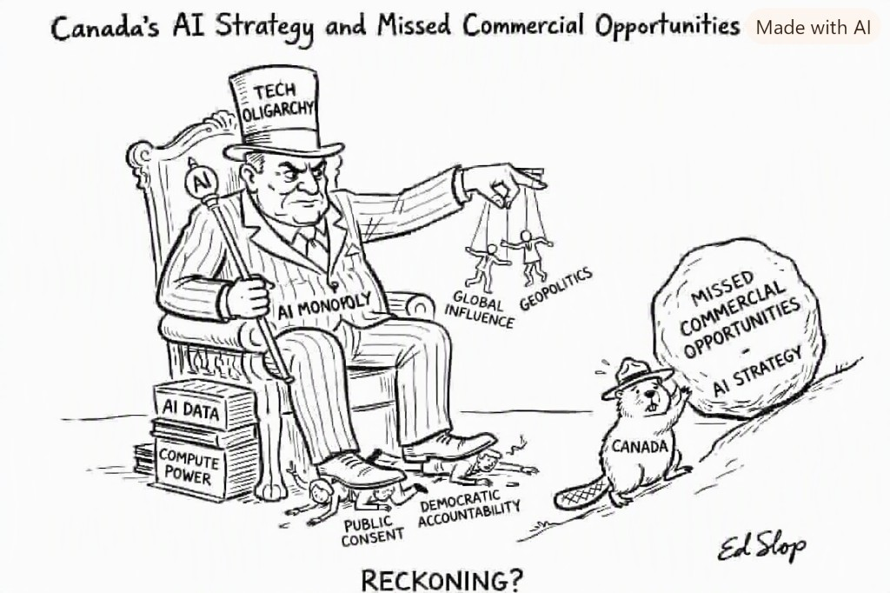
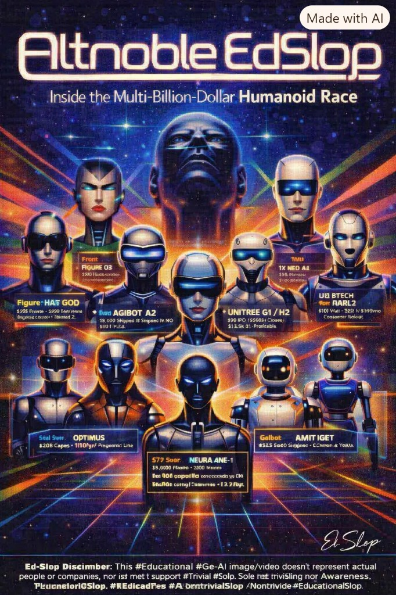
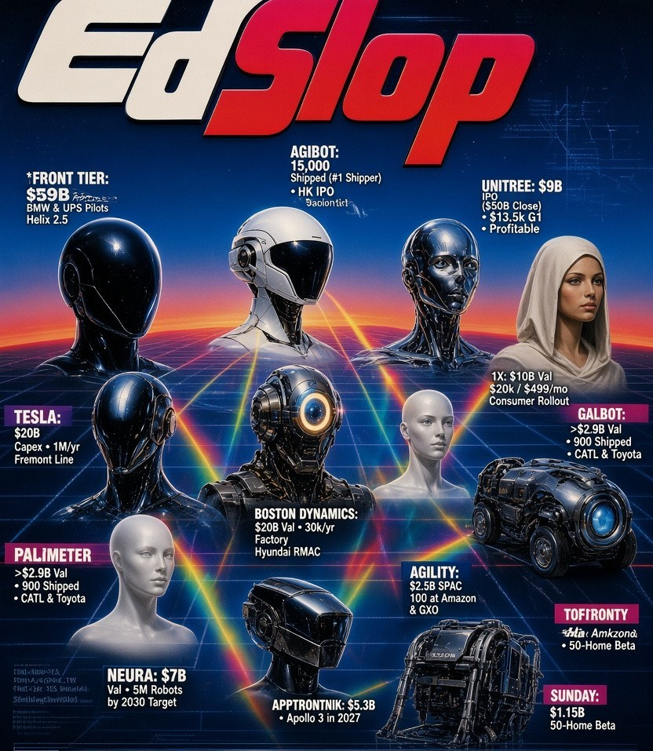
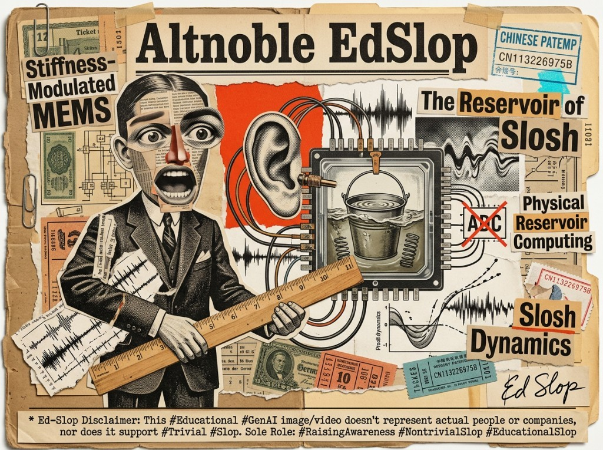
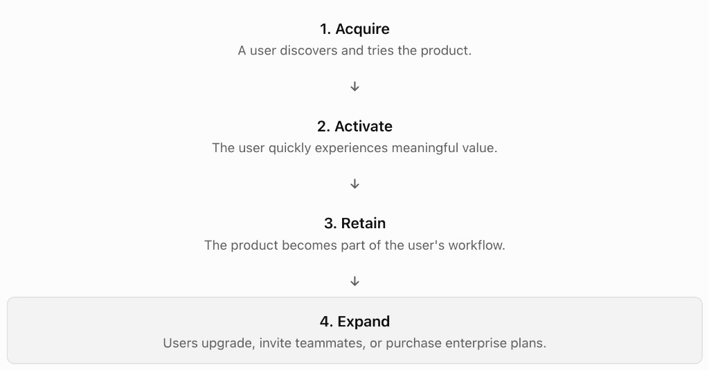
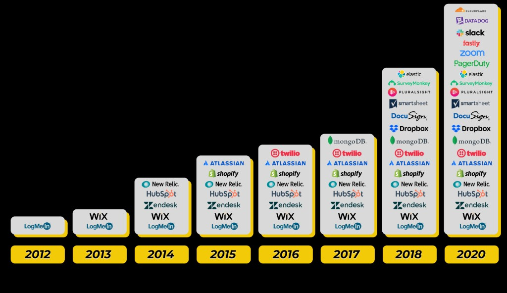

<h1></h1>

[Search the glossary](https://htmlpreview.github.io/?https://raw.githubusercontent.com/pedramgoshATgmail/EVALATHAN/main/docs/glossary.html?v=plgout). That page is the glossary, with its lettering and images, and the search slot is on the same page. Type a letter and the matching entries appear. Choosing a word moves to that entry.

Evalathan is one evaluation harness. [Hydra](#hydra) is the conductor for sixteen software evalers. [Dehydrus](#dehydrus) is the conductor for seven physical-world evalers under [PRETRUWs](#pretruws). Each entry below has the same three parts.

 What is counted, whether that count is a yes-or-no pass, and the three endings a cell can have. Measured means the file or the code was there and a result was written. Claim means a sentence is on disk and this run did not re-check it. Blank means the needed record is missing. A blank is not a fail and not a zero.

 Explanations in simple terms.

 More technically detailed explanations.

The life-cycle gate on each evaler (G0 through G12) is the station's place in the life of a product. There are not sixteen gates. There are sixteen evalers.

<h2>Hydra</h2>

<h3></h3>

Hydra calls the sixteen evalers and writes each report beside the others. She counts how many ran, how many passed their own gate, and how many are deferred. She does not turn a blank into a zero, and she does not fold the sixteen into one number. She is not a seventeenth score.

<i>She calls the sixteen. She does not add a score.</i>

<h3></h3>

The conductor. She points at each evaluator and writes down what it assessed and reported. She does not hand the evaluator group's results ae a single score or grade for the whole assessment group (16 current evaluators).

<h3></h3>

`conduct` walks the sixteen evalers in order. Stackly is the one that receives the earlier cells, because that evaler accepts them. The headline of the report is how many ran, how many passed their own gate, and how many are deferred. The saved record names the conductor Hydra. If the count is not sixteen, or a name is repeated, the run stops. The window heading is HYDRA.

<h2>Dehydrus</h2>

<h3></h3>

Dehydrus calls the seven PRETRUWs evalers and writes each report beside the others. He counts how many ran, how many passed their own gate, and how many are deferred. He does not turn a blank into a zero, and he does not fold the seven into one number. He is not an eighteenth Hydra score. He also prints a HabTwin filename line. That line is a utility, not an eighth evaler.

<i>He routes the seven. He does not add a score.</i>

<h3></h3>

The other conductor. Hydra watches software. Dehydrus watches locked physical worlds. Open `evalathan dehydrus` for his window. The heading is DEHYDRUS.

<h3></h3>

`evalathan dehydrus` opens the desk. `evalathan dehydrus scan <path>` writes seven cells: Copernly, Keplerly, Galileoly, Darwinly, Mendly, Einsteinly, Newtonly. Newtonly accepts the earlier cells and stays deferred until Keplerly and Galileoly both show a sealed world. The saved record names the conductor Dehydrus and the framework PRETRUWs. If the count is not seven, or a name is repeated, the run stops. Dehydrus is a conductor (orchestration engine / router), not a utility and not one of the seven.

<h2></h2>

<h3></h3>

Scans root and documentation directories for dedicated architectural manifests (e.g., ARCHITECTURE.md, /docs/architecture, C4 models, or ADR logs). Returns Pass if an architectural document exists, Fail if absent, and Deferred if docs are unparsable. It does not grade whether the architecture itself is optimal.

<h3></h3>

Before you buy a house, you check if blueprints exist. Archly checks if the software comes with a clear structural plan or if it was built blindly on the fly.

<h3></h3>

The public contents of the 97 principles are listed at [97 Things Every Software Architect Should Know](https://yoshi389111.github.io/kinokobooks/soft_en/index.html). MoE means that panel of expert authors, more than 50 of them. Their published lessons are the checklist. They do not log in and score the repository.

The scan reads the README and markdown under `docs`, `doc`, `architecture`, or `adr`. A principle is scored only when a file in this tree is evidence for it: 4 Strong when a document and a matching artifact both cite it, 3 Solid when one of those is present, 2 Emerging when only the README mentions it. A principle with no evidence stays deferred and is not entered as zero. The mean is the mean of the scored principles. It is not a pass. The international description of an architecture review is [ISO/IEC/IEEE 42030](https://www.iso.org/standard/73436.html). Archly does not issue that certificate. The same evidence rule scores five institutional standards beside the 97, and their mean is not folded into the 97 mean: [NASA Technology Readiness Level](https://www.nasa.gov/directorates/somd/space-communications-navigation-program/technology-readiness-level/), [ISO/IEC 25010](https://www.iso.org/standard/78176.html), ISO/IEC/IEEE 42030, [SEI ATAM](https://en.wikipedia.org/wiki/Architecture_tradeoff_analysis_method), and [AWS Well-Architected](https://aws.amazon.com/architecture/well-architected/).

<h2></h2>

<h3></h3>

Parses agent orchestrator configurations (e.g., YAML/JSON agent rosters) to tally registered agent identities, designated system prompts, and tool authorizations. Identifies unassigned workers or overlapping, ambiguous responsibilities.

<h3></h3>

The organizational chart for an AI bot team. It ensures every digital worker has a specific job title, defined tools, and clear duties so they don't trip over each other while working.

<h3></h3>

Roster files are `agent_registry.md`, `agents.md`, `agentic_registry.md`, or any markdown file inside a folder named `agents`. Rows that start with a bold table cell are counted. SASPIANT (Specific and Specialized, Pain-In-the-Ass, Non-critical Tasks) is the question the roster is for: is this a narrow chore, or a person-shaped decision. Chorely counts. It does not answer that question for you.

<h2></h2>

<h3></h3>

Parses supported Abstract Syntax Trees (ASTs) to compute cyclomatic and decision complexity points (counting if, elif, switch/match, for, while branches). Files in unsupported languages remain Blank/Deferred (which does not count as a pass or zero).

<h3></h3>

Like counting how many forks, roundabouts, and blind turns are on a road. Fewer turns make driving smooth; too many forks mean drivers (and programmers) are prone to getting lost or crashing.

<h3></h3>

The Python pack walks the syntax tree and counts `if`, `for`, `while`, `except`, `with`, and `assert` nodes inside functions. Named packs that are not executed in this version: JavaScript, TypeScript, C, C++, Rust, Go, and Java. An unknown suffix is a blank whose summary says it is not a pass. pytest, coverage, radon, and ISO/IEC 5055 are not launched. [ISO/IEC 5055](https://www.iso.org/standard/80623.html) is automated source-code quality measures. A radon run is not a 5055 result, and this scanner does not produce one.

<h2></h2>

<h3></h3>

Scans the repository's .git tree. Counts total historical commits, change intervals, and branch merges. Requires a valid local git history; repositories without git metadata return a Deferred status. This is an objective measurement of repository activity, not an assessment of developer ability or code quality.

<h3></h3>

Think of it like a construction site logbook. It doesn't judge whether the architect is a genius; it simply verifies that workers have consistently shown up and laid bricks on the schedule they claim.

<h3></h3>

The scan runs `git rev-list --count HEAD` when a `.git` folder is present and writes that integer. `passed` stays empty. If there is no git history, the cell is blank. Skills Framework for the Information Age (SFIA, a job-skill scale for technology work) is named so that nobody reads a level into the commit count. Devly does not award an SFIA level. The public framework is at [sfia-online.org](https://sfia-online.org/en/about-sfia).

<h2></h2>

<h3></h3>

Evaluates project-supplied question-and-answer manifests. Computes the coverage ratio and exact match/similarity score against a validated golden dataset. Distinct from generic unit tests - focuses on domain/subject-matter accuracy.

<h3></h3>

A subject-matter final exam. It tests how well your application answers specialized, real-world industry questions against an official answer key.

<h3></h3>

JSON or YAML files whose names contain `question` or `answer` are read. Questions are counted. Answers are matched by `id` when an answers file exists. `passed` stays empty. Runly and Codely remain the stations for a language conformance suite.

<h2></h2>

<h3></h3>

Scans for structured usability audit records, heuristic evaluations, or accessibility scorecards (e.g., WCAG compliance logs, UX benchmark JSONs). Marketing sentences or vague promises of "great UX" in a README yield no score.

<h3></h3>

Customer reviews backed by verifiable receipts. Instead of taking the developer's word that their app is "intuitive and user-friendly," Levi checks for actual recorded usability testing.

<h3></h3>

The file must be JSON whose family or brand contains `4uval`, with a `gate` object. The summary prints `gate.mean` and `gate.result`. [4Uvals](#user-content-4uvals) (Ultimate User-User-User evaluations) is the ten-check user-first scorecard, defined at that entry. [ISO/IEC 42001](https://www.iso.org/standard/81230.html) is an AI management system for a firm. Levi names it as a wrapper beside the sitting. It is not the grade. Levi prints the mean and the gate that are already on the card. It does not rescore the ten checks.

<h2></h2>

<h3></h3>

Inspects client-facing components for actual code-level pacing controls, break intervals, or integrated session switches (such as the repository's fuss/ module). General wellness advice written in markdown does not count as an implementation.

<h3></h3>

Checking if a car comes equipped with working seatbelts and speed limit warnings. It makes sure the software contains real code that encourages healthy work breaks, rather than quietly enabling non-stop screen addiction.

<h3></h3>

A Python function named `bind_fuss` or `bindfuss`, or an assignment to `session_limit_minutes`, is a timer. In JavaScript, `function bindFuss` is a timer, including the copy in [fuss/fuss.js](fuss/fuss.js). A file whose name is `fuss` is a timer. The provisional phrases are "take a break", "session limit", and "time budget". The bare word fuss is not enough. FUSS (For-User Session Switch) is the drop-in panel in [fuss/README.md](fuss/README.md). This is not a medical device and not an ISO certificate.

<h2></h2>

<h3></h3>

Scans the project tree, aggregates Source Lines of Code (SLOC) by file extension, and calculates the exact percentage distribution across languages while ignoring third-party vendor directories (e.g., node_modules/, site-packages/). Reports pure data without prescribing stack changes.

<h3></h3>

The ingredients label on a cereal box. It tells you exactly what percentage is wheat, corn, or sugar so you know what you are consuming before you take a bite.

<h3></h3>

Suffixes map to a language name: Python, JavaScript, TypeScript, C, C++, Rust, Go, Java, Kotlin, Ruby, PHP, C#, Swift, MEL, and VEX. The summary is a percentage of recognized files. Mixly does not parse those files and does not rank the languages.

<h2></h2>

<h3></h3>

Extracts metrics from existing compression logs, specifically recording raw byte reduction alongside objective image/video quality scores (e.g., SSIM, PSNR, VMAF, or CRF values). Pressly does not execute the compression pipelines during the evaluation scan.

<h3></h3>

Inspecting a vacuum-sealed suitcase. Pressly checks the luggage tag to confirm you actually shrank the package down to carry-on size without crushing the fragile items inside.

<h3></h3>

Logs, text, JSON, and markdown are scanned for `ssim`, `vmaf`, or `bytes`/`size` followed by a colon or an equals sign and a number. SSIM (structural similarity, a picture-likeness score) is described at [Wikipedia](https://en.wikipedia.org/wiki/Structural_similarity). VMAF (Video Multi-Method Assessment Fusion, Netflix's video-quality score) is at [Netflix/vmaf](https://github.com/Netflix/vmaf). A match is reported as a printed figure. It is not a TOKEX result.

<h2></h2>

<h3></h3>

Analyzes token-similarity and line duplication across files, cross-references internal function/class call graphs for orphaned/dead declarations, and tallies git change frequency per file. Flags files with high churn-to-complexity ratios as refactoring liabilities.

<h3></h3>

An inspector checking your house for duplicate furniture you bought twice, abandoned rooms in the attic that nobody uses, and a back door that squeaks so badly it needs weekly repairs.

<h3></h3>

Identical-byte groups are SHA-256 matches among files between 1 and 200,000 bytes. Unused names are Python functions and classes that are defined and never referenced, skipping names that start with `_` or `test`. Change is `git log --numstat` over the last 40 commits when git exists. The unused-name walk is the one language-specific check in this version. The copy check and the change check apply to whatever files are in the tree.

<h2></h2>

<h3></h3>

Measures wall-clock execution time for defined micro-benchmark routines or parses valid, pre-computed benchmark artifacts (e.g., pytest-benchmark JSON output). Defers execution if no executable targets or saved logs are present in the target directory.

<h3></h3>

A quick 100-meter sprint test. It checks how fast your software actually runs on the track right now, rather than trusting how fast the sales brochure claimed it was.

<h3></h3>

Any tree with Python source gets a local microbench: 200,000 integer steps, reported in milliseconds, labeled as an Evalathan microbench. Files whose names contain `pyperformance`, `spec2017`, or `llvm-test-suite` are noted and not executed. SPEC CPU is the industry suite at [spec.org](https://www.spec.org/cpu2017/). The LLVM test suite is a compiler project, not a file this scanner invents. [ISO/IEC 25010](https://www.iso.org/standard/78176.html) describes product quality, including performance efficiency. Runly does not compute a 25010 score.

<h2></h2>

<h3></h3>

Aggregates findings from the other 15 evaluators into a clean report matrix. Explicitly prohibits flattening heterogeneous measurements into a misleading single 0–100 score. Preserves Pass, Fail, and Deferred states as independent data points.

<h3></h3>

A detailed medical blood panel instead of a single 1-to-10 wellness score. It tells you exactly what is healthy, what needs attention, and what wasn't tested, giving you total transparency.

<h3></h3>

`ACCEPTS_PRIOR` is set, so Hydra passes the earlier cells in. `passed` stays empty on purpose. The headline of the report is the same vector: ran, passed, deferred.

<h2></h2>

<h3></h3>

Ingests structured LLM transaction logs containing baseline and optimized token usage pairs. Calculates the net token delta (Tokens before - Tokens after). If token records are not saved in the target path, the cell is marked Deferred rather than zero.

<h3></h3>

A fuel economy tracker for AI apps. It measures how much gas (tokens) your prompts burned before vs. after tuning to make sure you aren't wasting money on bloated queries.

<h3></h3>

JSON may use `before` and `after`, or `total_tokex` and `tokex_this_run`, including those keys inside a `tokex` object. TOKEX (Token Expenditure) is the name of that count. Tokely does not import a tokenizer and does not call a model. Pressly's byte counts are a different measurement.

<h2></h2>

<h3></h3>

Analyzes sequential execution logs of agentic tasks. Counts total steps taken, tool call frequencies, backtracking loops, and final task resolution states. Disregards third-party leaderboard claims that lack inspectable raw trace files.

<h3></h3>

The flight data recorder (black box) for an autonomous agent. It tracks every turn the agent took to solve a problem so you can see whether it flew straight to the target or took five dizzying loops.

<h3></h3>

File names containing `trace`, `trajectory`, or `passk` are read. JSONL lines that parse as JSON are counted as steps. Other matching files count as one step. The summary says the count is from files in the tree.

<h2></h2>

<h3></h3>

Validates the presence of an explicit Engineering Priority Triad declaration that orders Cost, Speed/Latency, and Impact. Evaluates whether the team has officially declared which compromise comes first when system constraints collide.

<h3></h3>

The golden rule of any workshop: "Cheap, Fast, or Good - pick two." Triadly verifies that your team explicitly wrote down which one matters most before building the product.

<h3></h3>

Mc (Min Cost) · Me (Max Efficiency/speed) · Mi (Max Impact/quality); order = priority left-to-right. Six orders: McMeMi cheap interceptor drone; McMiMe Shahed-style; MeMcMi ambulance drone; MeMiMc fighter scramble; MiMcMe SEISMO MVP target, impact then cost; MiMeMc NASA rocket and Patriot missile, impact then speed.

The accepted compact orders are `mcmemi`, `mcmime`, `memcmi`, `memimc`, `mimcme`, and `mimemc`, read from the README and from markdown, JSON, and text. The scan looks for those codes with spaces removed. It does not treat the word M3, by itself, as an order.

<h2></h2>

<h3></h3>

Cross-references listed performance claims and product assertions against linked source code, test seeds, external dataset URLs, or academic citations. Claims without verifiable backing artifacts fail the check.

<h3></h3>

The "show your work" math test rule. If your software claims to be 10x faster or 99% accurate, Warrantly checks if you provided the actual proof or just made an empty sales pitch.

<h3></h3>

JSON may be a list of objects with a `claim` key, or an object with `claims` or `warrants`. Backing is any of `source`, `recipe`, or `evidence`. The pass flag is true only when the backed count equals the claim count and the list is not empty.

<h2>4Uvals</h2>

4Uvals (Ultimate User-User-User evaluations) is a 10-check list. The question is whether a session with an AI actually put the person using it first. Levi reads the card when a copy is in the tree. 4Uvals is not a seventeenth evaler.

<h3></h3>

The published card is 4Uvals v1.2. The people who ran the sitting scored it themselves. The gate is PASS. Nine of the ten checks are Solid or Strong. The mean is 3.4 out of 4. Scores use a 1–4 scale: 4 Strong, 3 Solid, 2 Emerging, 1 Weak. U5 is Emerging because it was declared and not measured. That cell stays Emerging. It is not written down as a fail, and it is not written down as zero.

A freeze, the choice to pause the session, is optional on purpose. An adult can leave it off. It is not a lock built for a child.

Sixteen published usability and health standards are housed under the card as comparisons. They are not added into the ten checks, and they are not averaged into the 3.4.

<h3></h3>

4Uvals stands for Ultimate User-User-User evaluations. It asks, in ten plain questions, whether this sitting put the user first. The published answer is a pass: 9 of 10 checks are Solid or Strong, and the average is 3.4 out of 4. One question, about retelling the work, was named and not measured. NASA-TLX (NASA Task Load Index, a short questionnaire for how hard a task felt) on this card is one educated user scoring 9 out of 100, inside the low band of 0–24. That is one person's score. It is not a NASA certificate. The card is not an ISO, IEEE, IEC, W3C, FDA, or NASA certificate.

<h3></h3>

Stamp on the card: 4Uvals v1.2. Ten checks, U1–U10. First-order means the operator scored the sitting. The pass rule used on this card is a mean of at least 3.2 and at least 8 of 10 checks Solid or Strong. This card clears both: mean 3.4, and 9 of 10. [ISO/IEC 42001](https://www.iso.org/standard/81230.html) is named beside the sitting as the firm-level wrapper (U4). It is not the sitting grade.

| ID | Check | Score | Label |
| :--- | :--- | ---: | :--- |
| U1 | Rubric stem | 3 | Solid |
| U2 | Loyalty language | 3 | Solid |
| U3 | Cite the legal gap | 4 | Strong |
| U4 | Outer wrapper, ISO/IEC 42001 | 3 | Solid |
| U5 | Retell, map then measure then manage | 2 | Emerging |
| U6 | FUSS (For-User Session Switch) instrument | 3 | Solid |
| U7 | Preface discipline | 4 | Strong |
| U8 | Honor the person, and keep freeze optional | 4 | Strong |
| U9 | Well-being axis | 4 | Strong |
| U10 | Footnote only, not medical | 4 | Strong |

The housed sixteen are analogs. An analog is a comparison with a published standard. It is not folded into the mean.

| # | Instrument | Analog |
| :--- | :--- | :--- |
| 1 | [ISO 9241-210:2019](https://www.iso.org/standard/77520.html) | 2 Emerging |
| 2 | [ISO 9241-110](https://www.iso.org/standard/75258.html) | 3 Solid |
| 3 | ISO 9241-300 series | 2 Emerging |
| 4 | ISO 9241-400 series | 1 Weak |
| 5 | ISO 10075-1 | 3 Solid |
| 6 | ISO 10075-2 | 2 Emerging |
| 7 | ISO 10075-3 | 1 Weak |
| 8 | [ISO/IEC 25019:2023](https://www.iso.org/standard/78177.html), quality in use | 3 Solid |
| 9 | [IEEE 7010-2020](https://standards.ieee.org/ieee/7010/7718/) | 3 Solid |
| 10 | [WCAG 2.1](https://www.w3.org/TR/WCAG21/) (Web Content Accessibility Guidelines) | 2 Emerging |
| 11 | [WCAG 2.2](https://www.w3.org/TR/WCAG22/) | 2 Emerging |
| 12 | ISO/IEC 40500, the ISO adoption of WCAG | 2 Emerging |
| 13 | IEC 62366-1 | 2 Emerging |
| 14 | [NASA-TLX](https://ergosphere.com.au/tools-nasa-tlx.html), first-order, one person, 9/100 | 3 Solid |
| 15 | SUS (System Usability Scale) and [UEQ+](https://www.ueq-online.org/) (User Experience Questionnaire Plus) | 2 Emerging |
| 16 | CVS-Q (Computer Vision Syndrome Questionnaire) | 1 Weak |

H14 on the card is the NASA-TLX row: one educated user, overall 9 out of 100, low band 0–24. SUS and UEQ+ are named. Their item scores are not on the card, so none are printed here. CVS-Q was not administered. None of these sixteen is a certificate.

<h2></h2>

SELFBELT is the seatbelt write-up for people who sit with software, including AI tools, for a long time. The pages are on [SELFBELT](docs/SELFBELT.md). The practice named inside the document is SELFBELTING. The button name and the page name are SELFBELT.

<h3></h3>

SELFBELT is not one of the sixteen evalers and it does not add a seventeenth score. Menschly is the evaler that can see a timer. The PDF is the explanation a developer can read and, if they choose, ship beside their own software.

<h3></h3>

Think of the early car. Lights, signs, and laws showed up before the seatbelt. A lot of software today has the lights: filters, policies, usage caps written by the vendor. The belt is the habit the person puts on. SELFBELT is that write-up. FUSS is a belt you can clip into a product: a small panel that asks whether to time the sitting.

Ralph Nader's *Unsafe at Any Speed* (1965) pushed crash safety into the car instead of leaving it as optional chrome. The analogy stops there. SELFBELT is not a law, not a medical claim, and not a statement that one sitting harms a brain.

<h3></h3>

Menschly links here. The drop-in timer is [fuss/README.md](fuss/README.md). Installing FUSS is optional. A product can pass Menschly with any real stop, and a product with no sitting stays blank. Nothing in the PDF is scraped into a numeric grade.

<h2>FUSS</h2>

<h3></h3>

FUSS (For-User Session Switch) is not one of the sixteen evalers and it does not add a seventeenth score. It is a panel a developer can copy into a product. Menschly is the evaler that can see a timer. A sentence that merely names FUSS is not a timer.

<h3></h3>

FUSS is a timer a person can turn on inside software they use for a long time. It is not an agent, not medical advice, and not a lock. The panel is a small card. The logo sits in the center. It asks whether to time this sitting, then lets a person set the minutes, the reminder spacing, the days, and an optional end date.

<h3></h3>

Copy the `fuss` folder into a web page or a desktop web view. The same files run on Windows and Mac. Before the end of the page, one script tag loads [fuss/fuss.js](fuss/fuss.js). A desktop app shows [fuss/index.html](fuss/index.html) in a web view. The choices stay in the browser's local storage on that computer. The script's starting setup is 25 minutes a sitting, a reminder every 15 minutes, all days, and no end date. Each person still has to tick the box and press Use FUSS. The panel does not start a timer for someone who said no. Menschly treats `function bindFuss` in that file as a timer. The write-up is [fuss/README.md](fuss/README.md).

<h2>Ed Slop</h2>

'Ed Slop' is an AI nom de plume found at the bottom of some of the art and illustrations in Evalathan glossary. Ed Slop is short for Educational Slop (Generative AI visuals) and it doesn't represent any living or human artist, nor does it support trivial slop. Ed Slop's purpose is illustrative imagery and art to help readers better understand complex topics, all through ethical, nontrivial Generative AI creations.

The above are sample Ed Slops from <a href="https://aito.network/en#quarterlies">aiTO</a> and <a href="https://www.facebook.com/reel/3661274200704299">Altnoble</a> PRs.

<h2>Product-led growth</h2>

Product-led growth (PLG) is a business strategy in which the product itself drives customer acquisition, adoption, retention, and revenue growth. Instead of relying primarily on salespeople to convince customers to buy, a PLG company lets users experience the product's value directly, often through a free tier, free trial, or self-service onboarding. The key principle is: make the product demonstrate its own value before asking the customer to commit. This entry is the definition. It is not an evaler.

<h3></h3>

PLG is not one of the sixteen evalers and it does not add a seventeenth score. A folder scan cannot see who discovered the product, who reached a useful outcome, who kept it in their work, or who paid. Those facts stay off the report.

<h3></h3>

The product does the introducing. Someone finds it and tries it. They reach a useful result quickly, with little setup. It becomes part of how they work. Then they upgrade, invite a teammate, or buy a larger plan.

Slack: Teams adopt it, experience the value of collaboration, and expand usage across their organization.

Notion: Individuals start organizing their work and later introduce the platform to their teams.

Figma: Designers collaborate in the product, naturally encouraging colleagues and stakeholders to join.

A sales team can still close a large account. PLG does not eliminate enterprise sales. Many successful companies combine product-led adoption with sales-led enterprise expansion.

<a href="https://productled.com/">Source: ProductLed</a>

<h3></h3>

Two public definitions agree on the engine and use a different middle word. [ProductLed](https://productled.com/blog/product-led-growth-definition), Wes Bush, 2 Aug 2023: product-led growth is a business strategy that relies on using your product as the main vehicle to acquire, activate, and retain customers. Engagement comes before payment, usually through a free tier or a free trial. [1up.ai](https://1up.ai/encyclopedia/product-led-growth), citing OpenView Partners: a go-to-market strategy that uses the product as the primary driver of customer acquisition, engagement, and retention, so users invite others. The figure uses four stations: Acquire (a user discovers and tries the product), Activate (the user quickly experiences meaningful value), Retain (the product becomes part of the user's workflow), Expand (users upgrade, invite teammates, or purchase enterprise plans).

What makes the strategy hold: time to value, low-friction onboarding, a product people can use without a guide, a loop where one user brings the next, and an upgrade that follows use.

| Dimension | Product-led growth | Sales-led growth |
| :--- | :--- | :--- |
| Primary growth engine | Product experience | Sales team |
| Customer entry | Self-service | Sales engagement |
| Conversion trigger | Experienced value | Sales process and business case |
| Best fit | Products users can try independently | Complex enterprise solutions |
| Typical challenge | Converting free users to revenue | High acquisition costs and longer sales cycles |

For an AI product such as Evalathan, PLG means making the product sufficiently useful and accessible that developers discover its value, integrate it into their workflows, and become advocates - while the business converts sustained usage into paid accounts. The runner does not compute a PLG rate. Levi remains the user-first card. Warrantly remains the claim-and-source check.

<h2>PRD</h2>

PRD (Product Requirements Document - what a product must do, not how to build it) is a write-up of the capabilities a release must include. This entry is the definition. It is not an evaler.

<h3></h3>

PRD is not one of the sixteen evalers and it does not add a seventeenth score. Hydra may print that a named PRD file was found. If none is in the tree, the line is No PRD found. That line is not a fail and not a zero. Archly still scores architecture evidence. A sentence that merely names a PRD is not a specification. This is not an ISO/IEC/IEEE 29148 certificate.

<h3></h3>

The shopping list for the product. It says what done means for the people who will use it. It does not pick the bricks. Some teams keep that list as stories instead of one long file. Missing the file is common, and the scan says so in one line.

<h3></h3>

Wikipedia and ProductPlan agree: the document states capabilities and use cases and should not dictate implementation. [Atlassian](https://www.atlassian.com/agile/product-management/requirements) describes a short shared page: purpose, features, user needs, and success criteria. In [Agile](https://en.wikipedia.org/wiki/Agile_software_development) work that page stays short, links out, and is written with the team. Feature rows may carry a [MoSCoW](https://en.wikipedia.org/wiki/MoSCoW_method) (Must, Should, Could, Won't) priority. Engineering may then write a functional specification and an architectural design. ISO/IEC/IEEE 29148 is the software requirements specification (SRS) standard, which superseded IEEE 830.

The scan looks for a file whose stem is `prd`, `product-requirements`, or `product_requirements`, with a `.md`, `.rst`, `.txt`, or `.adoc` suffix. Presence prints `PRD found:` and the relative path. Absence prints `No PRD found`. Headings are not a completeness percent. A README sentence is not a file. [PRDBench](#prdbench) is an exam of agents that implement a PRD. It is not this line.

<h2>PRETRUWs</h2>

<h3></h3>

PRETRUWs (Prediscovery Truncated Universe and Worlds) is the v0.3 4IR (Fourth Industrial Revolution) framework. It is not a Hydra evaler. Dehydrus writes seven cells. A missing world is blank, not a fail and not a zero. Spec: [docs/PRETRUWs.md](docs/PRETRUWs.md). Roadmap: [docs/BUILDLOG.md](docs/BUILDLOG.md).

<h3></h3>

A locked room from a past year. The exam has to work with what that year could see, and with what that one person could have reached. Saying "pretend it is 1610" is not enough. Later facts have to be actually gone.

<h3></h3>

Manifesto direction: *Until Artificial Intelligence Independently Eurekas on its own*, after [Adaptive Software Development](https://en.wikipedia.org/wiki/Adaptive_software_development) (Jim Highsmith, 1997: messy, exciting, and anxiety-ridden; second world = unpredictable, nonlinear, fast). PRETRUWs states a third world: multi-predictable, bilinear and supralinear, hyperfast / instancy-nearest, and polydeterminism. Framework PRETRUWs holds methodology [LuDaTs](#ludats). Each brand is one method. Braidware (SEISMO glossary) is agentics, software, and hardware as one unit. LLM (Large Language Model) and RAG (Retrieval-Augmented Generation) stacks are plugins, not extra Hydra cells.

<h2>Copernly</h2>

<h3></h3>

No gold medal in v0.3 from a filename. Copernly (code LuDaTs-C) is deferred until a sealed world file is in the tree. A blank is not a fail.

<h3></h3>

Same old sky numbers, new picture of the sky. No new telescope. The year is 1542, before [*De revolutionibus orbium coelestium*](https://en.wikipedia.org/wiki/De_revolutionibus_orbium_coelestium) (1543).

<h3></h3>

Mode A. Gold medal: sun-centered kinematic model; fewer epicycles than the Ptolemaic fit on the same archive; earth as a planet. Not gold: the string "heliocentrism". Card: [exams/ludats/ludats-c-copernicus.yaml](exams/ludats/ludats-c-copernicus.yaml).

<h2>Darwinly</h2>

<h3></h3>

Required world. No gold medal in v0.3 from a filename. Darwinly (LuDaTs-D) is deferred until a sealed 1858 field world is in the tree.

<h3></h3>

Years of walking, breeding, and notes, not one night and not the finch cartoon. The book [*On the Origin of Species*](https://en.wikipedia.org/wiki/On_the_Origin_of_Species) is 1859, so the freeze is 1858.

<h3></h3>

Mode D. Gold medal: descent with modification; a selection mechanism that can accumulate. Not gold: the string "evolution"; genetics after 1858. Card: [exams/ludats/ludats-d-darwin.yaml](exams/ludats/ludats-d-darwin.yaml).

<h2>Einsteinly</h2>

<h3></h3>

No gold medal in v0.3 from a filename. Einsteinly (LuDaTs-E) is General Relativity only. 1905 is a different freeze.

<h3></h3>

A leftover that Newton's gravity cannot eat (Mercury). Write the new field equations in 1914-1915. The 1919 eclipse is a check after the theory, not a hint before it.

<h3></h3>

Mode F. World clock 1914. Gold medal: field equations whose weak-field limit recovers Newton; Mercury perihelion; light deflection checked only after submission. Not gold: the string "general relativity"; photoelectric / Brownian / 1905 special relativity. Card: [exams/ludats/ludats-e-einstein-gr.yaml](exams/ludats/ludats-e-einstein-gr.yaml).

<h2>Galileoly</h2>

<h3></h3>

Required world. Physical-world flagship. Galileoly (LuDaTs-G) is deferred until a sealed optic-and-kinematics world is in the tree.

<h3></h3>

A new eye (the optic) plus experiments on earth. Not "he invented heliocentrism." That belongs to Copernly.

<h3></h3>

Mode C. 1608 optic; 1637 kinematics. Gold medal: Jupiter's satellites; Venus phases; irregular Moon; incline / falling-body regularity. Not gold: the string "heliocentrism". Card: [exams/ludats/ludats-g-galileo.yaml](exams/ludats/ludats-g-galileo.yaml).

<h2>Keplerly</h2>

<h3></h3>

No gold medal in v0.3 from a filename. Keplerly (LuDaTs-K) is deferred until a sealed Mars-table world is in the tree.

<h3></h3>

Better numbers, same kind of eye. Tycho's Mars table, still naked-eye class. Not the same quiz as Copernly.

<h3></h3>

Mode B. 1608 / 1618. [*Astronomia nova*](https://en.wikipedia.org/wiki/Astronomia_nova) 1609, [*Harmonices mundi*](https://en.wikipedia.org/wiki/Harmonices_Mundi) 1619. Gold medal: elliptical orbit; equal areas in equal times. Not gold: naming Kepler's laws; using a telescope. Card: [exams/ludats/ludats-k-kepler.yaml](exams/ludats/ludats-k-kepler.yaml).

<h2>Mendly</h2>

<h3></h3>

No gold medal in v0.3 from a filename. Mendly (LuDaTs-M) hides the later names of the missing cards.

<h3></h3>

A table with holes. The exam later checks whether the holes were the right shape, without saying "gallium" or "germanium" inside the 1868 room.

<h3></h3>

Mode E. 1868. Ga 1875 and Ge 1886 are hidden labels. Gold medal: periodic grouping of the 1868 set; eka-aluminium and eka-silicon property cards. Not gold: printing a modern periodic table. Card: [exams/ludats/ludats-m-mendeleev.yaml](exams/ludats/ludats-m-mendeleev.yaml).

<h2>Newtonly</h2>

<h3></h3>

On the full desk. Deferred to v2. Newtonly (LuDaTs-N) waits until Keplerly and Galileoly both show a sealed world.

<h3></h3>

One law for the sky and the ground. The apple story is folklore and is not the exam.

<h3></h3>

Unification of Keplerly + Galileoly. Freeze 1686, [*Principia*](https://en.wikipedia.org/wiki/Philosophi%C3%A6_Naturalis_Principia_Mathematica) 1687. Gold medal: inverse-square universal gravitation; celestial and terrestrial the same law. Card: [exams/ludats/ludats-n-newton.yaml](exams/ludats/ludats-n-newton.yaml).

<h2>Conductor</h2>

<h3></h3>

Not a score. Hydra and Dehydrus are conductors. A conductor is not an extra evaler.

<h3></h3>

The person at the front who points at each player and writes what that player reported. They do not play a seventeenth or eighth instrument.

<h3></h3>

Orchestration engine. The router job lives inside the conductor (order, prior cells, headline). See [docs/PRETRUWs.md](docs/PRETRUWs.md).

<h2>Engine</h2>

<h3></h3>

Not a Hydra cell. An engine emits cells or a headline.

<h3></h3>

The machine that writes the report, or the machine that writes one line of the report.

<h3></h3>

Hydra, Dehydrus, each evaler, and the planned HabTwin scorer are engines. A framework (PRETRUWs, HabTwin) is not itself an engine.

<h2>Agent</h2>

<h3></h3>

Not a count by itself. The sixteen and the seven are agentic evalers.

<h3></h3>

A worker that judges or acts. Plugins that a world needs (a language model, a retriever) are also agents. They are not extra Hydra cells.

<h3></h3>

Agentic = can plan, use tools, or judge. Utility is the opposite: a deterministic look-up.

<h2>Utility</h2>

<h3></h3>

Not an evaler. The PRD line and the HabTwin filename line are utilities.

<h3></h3>

A lookup. It does not award a gold medal.

<h3></h3>

Deterministic transform. No gate. No `passed` flag.

<h2>Router</h2>

<h3></h3>

Not a score. Routing is the job inside a conductor.

<h3></h3>

Who speaks next, and who may see the earlier answers.

<h3></h3>

Dehydrus routes the seven. Hydra routes the sixteen. A router pattern is not a second product.

<h2></h2>

These are public exams for coding agents and for chat models. They matter in this period. Evalathan does not run them in the laptop scan, and it does not paste their leaderboards. That is a scope fact, not a dismissal. Trajectly is the station that will count one of them on the day a saved trace from that exam is in the folder you scan. A percent copied from a website is still not a grade.

The same shelf holds retrieval catalogs. A catalog is a list of public scores. It is not an exam, and it is not on the vector. It also holds [PRDBench](#prdbench), which grades an agent that builds from a [PRD](#prd). [LuDaTs](#ludats) is not on this shelf. It sits under [PRETRUWs](#pretruws) and [Dehydrus](#dehydrus).

<h2></h2>

<h3></h3>

No Evalathan score. The public board is someone else's number. The cell stays off the vector until a trace file from a run is in the tree.

<h3></h3>

SWE-bench (Software Engineering Benchmark) is a set of real GitHub issues a coding agent is asked to patch. The full public set is large and is graded in containers. That does not fit a laptop scan of an ordinary folder. Evalathan can say the name. It does not pretend it sat the exam.

<h3></h3>

The project site is [swebench.com](https://www.swebench.com/). A short public account is on [Wikipedia](https://en.wikipedia.org/wiki/SWE-bench). Trajectly would count a local file whose name contains `trace`, `trajectory`, or `passk`. It will not count a screenshot.

<h2></h2>

<h3></h3>

Same as SWE-bench. Not on the vector. The public slice is still a lab run.

<h3></h3>

SWE-bench Pro is a harder, later set from the same family, with a public slice and private slices. It is the right ambition for a hosted exam on a machine that can run it. It is too much work for the current laptop scan, and a copied percent would not make Evalathan more true.

<h3></h3>

The paper is [arXiv:2509.16941](https://arxiv.org/abs/2509.16941). Inclusion later means a frozen task folder, the grader that ships with it, and a trace Trajectly can count. It does not mean embedding the live leaderboard.

<h2></h2>

<h3></h3>

Not on the vector. No trace, no cell.

<h3></h3>

DeepSWE is a smaller public agent exam, on the order of a hundred handwritten tasks, at deepswe.datacurve.ai. Smaller does not make it a laptop feature. It joins the same menu as the SWE-bench family: host it when the grader and the trace are yours.

<h3></h3>

The public page is [deepswe.datacurve.ai](https://deepswe.datacurve.ai/). Evalathan does not download that board and does not average it with anything else.

<h2>PRDBench</h2>

<h3></h3>

No Evalathan score. PRDBench grades an agent that builds from a PRD. The public board is someone else's number. The cell stays off the vector. Finding a named PRD file in the tree is not sitting this exam.

<h3></h3>

The agent is given a product write-up and a test plan, then asked to build the software. A separate judge checks the result. Evalathan can say the name. It does not pretend it sat the exam, and it does not paste the board.

<h3></h3>

The paper is [arXiv:2510.24358](https://arxiv.org/abs/2510.24358), submitted 28 Oct 2025. The public tree is [AGI-Eval-Official/PRDBench](https://github.com/AGI-Eval-Official/PRDBench). Fifty Python tasks across twenty domains. Each task keeps `src/PRD.md` and `evaluation/detailed_test_plan.json`. Evaluation uses an Agent-as-a-Judge. Evalathan does not run that judge and does not copy a percent. A named PRD file in a scanned folder is printed on its own line. That line is not this exam.

<h2>LuDaTs</h2>

<h3></h3>

LuDaTs (Limited-universe Data Test sets) is the PRETRUWs methodology family, not a Trajectly exam and not a seventeenth Hydra evaler. Dehydrus calls the seven brands. A missing world is blank, not a fail and not a zero. A gold medal is the structural prize for that world, not a sports rank of the product.

<h3></h3>

LuDaTs locks the agent in a dated world: only the news, instruments, and papers that existed at that year, and only what that discoverer could have reached at that age. It then has to form the theory by acting in a simulator whose later facts are gone. Naming the later textbook title is not a gold medal. Galileo, Copernicus, and Kepler are three different tests, not one astronomy quiz. Newton waits.

<h3></h3>

Spec: [docs/LuDaTs.md](docs/LuDaTs.md). Machine cards: [exams/ludats/](exams/ludats/). Brands: [Copernly](#copernly) (LuDaTs-C, 1542, pre [*De revolutionibus orbium coelestium*](https://en.wikipedia.org/wiki/De_revolutionibus_orbium_coelestium)), [Keplerly](#keplerly) (LuDaTs-K, 1608), [Galileoly](#galileoly) (LuDaTs-G, required), [Darwinly](#darwinly) (LuDaTs-D, required), [Mendly](#mendly) (LuDaTs-M, 1868), [Einsteinly](#einsteinly) (LuDaTs-E, 1914, not 1905), [Newtonly](#newtonly) (LuDaTs-N, v2). Two clocks: world year T, biography age A. [ExAnte](https://aclanthology.org/2026.eacl-long.72/) (ACL 2026) showed prompt cutoffs leak. Domly is the wrong station. The sixteen stay sixteen.

<h2>HabTwin</h2>

<h3></h3>

HabTwin is an innovative twin-fidelity exam: person-specific, distributional, leak-gated, lab-only. It is not a Hydra evaler and not a Trajectly exam. Dehydrus prints `No HabTwin lab trace` or the sealed filename. v0.3 does not guess. A blank is not a fail and not a zero. Spec: [docs/HabTwin.md](docs/HabTwin.md).

<h3></h3>

A twin is real when it predicts what the real person or machine would do, in a lab, more than once. **P** is the person (or machine) you claim to copy. **Q** is someone else, used as a check. The **crowd** is "people in general." Matching a live password is not the prize.

<h3></h3>

A digital twin is validated when it predicts the counterpart's measurable outputs under a stated use ([ISO 23247](#iso-23247) [VVUQ](#vvuq); NASEM digital-twin report). HabTwin scores the signature, discriminates P from Q and from the crowd, and, for machines, scores policy plus lab-generator next-sample. Exact match on synthetic secrets is a ceiling metric. It is not the definition of twin. Cells: HabTwin-C (composition), HabTwin-D (discrimination), HabTwin-S (system), HabTwin-X (exact-match ceiling), HabTwin-K (keystroke, deferred). Live login is forbidden. Human digital twins in medicine are being told to run VVUQ, not a password parlor trick ([npj Digital Medicine 2025](https://www.nature.com/articles/s41746-025-01447-y); [ISO/AWI 23247-8](https://www.iso.org/standard/94858.html)).

Not to do: do not target live people or production systems; do not ship wordlists or cracking loops; do not treat a password-manager user as a fail; do not mash HabTwin-C into keystrokes; do not add HabTwin to Hydra or Trajectly; do not call exact match the definition of twin.

<h2>ISO 23247</h2>

<h3></h3>

Not an Evalathan score. It is the manufacturing digital-twin framework HabTwin cites.

<h3></h3>

The public rulebook for what a factory-style digital twin is supposed to predict.

<h3></h3>

[ISO 23247](https://www.iso.org/standard/75066.html) (Digital twin framework for manufacturing). Part 8 is [ISO/AWI 23247-8](https://www.iso.org/standard/94858.html) VVUQ for digital twins (work item, not a finished certificate). Evalathan does not issue that certificate.

<h2>VVUQ</h2>

<h3></h3>

Not an Evalathan score. VVUQ (Verification, Validation, and Uncertainty Quantification) is the check HabTwin uses instead of "said the password."

<h3></h3>

Did the model run as written? Does it predict the real thing under a stated use? How unsure is that prediction?

<h3></h3>

Verification: the code does what the spec says. Validation: the prediction matches the counterpart under a stated use. Uncertainty quantification: confidence bounds across draws. Cited from the NASEM digital-twin report and [npj Digital Medicine 2025](https://www.nature.com/articles/s41746-025-01447-y).

<h2></h2>

<h3></h3>

AOSE is a field, not a score Evalathan prints.

<h3></h3>

AOSE (agent-oriented software engineering) is the research tradition of building software as cooperating agents. The Wikipedia page also carries a mixed table of newer benchmarks. Those rows are a catalog. They are not sixteen more evalers, and they are not a grade of the folder you just scanned.

<h3></h3>

The field overview is [Wikipedia: Agent-oriented software engineering](https://en.wikipedia.org/wiki/Agent-oriented_software_engineering). Names that show up in that public catalog, besides the SWE-bench family, include AgentBench, tau-bench, WebArena, WildBench, and Test of Time. Evalathan does not collapse that table into one number.

<h2></h2>

<h3></h3>

Not on the vector. WildBench grades chat replies. It is not a trace of a coding agent unless you saved one.

<h3></h3>

WildBench is a public benchmark of hard chat tasks drawn from real use. It is worth knowing about. Evalathan does not host it and does not quote its board. It would show up under Trajectly only if you saved a run in the folder.

<h3></h3>

The paper is [arXiv:2406.04770](https://arxiv.org/abs/2406.04770). No leaderboard percent from that paper is copied into a cell.

<h2>Ragas</h2>

<h3></h3>

No Evalathan score. v0.2 does not run a retriever and does not call the judge model these scores use. The four assessed figures stay off the sixteen. A later version can read a log a run already wrote, the way Pressly reads a compression log, and print each figure on its own line. It will not blend them.

<h3></h3>

Ragas is a public library of scores for a system that looks things up and then answers. The lookup and the answer are graded separately. Evalathan can name the scores. It does not sit the test, and it does not paste a number from someone else's run.

<h3></h3>

The retrieval list on the [Ragas metrics page](https://docs.ragas.io/en/stable/concepts/metrics/available_metrics/), read 27 Oct 2026, is Context Precision, Context Recall, Context Entities Recall, Noise Sensitivity, Response Relevancy, Faithfulness, Multimodal Faithfulness, and Multimodal Relevance. Pages in that set are dated 9 Dec 2025 and 11 Dec 2025. The same page also names other catalogs: Nvidia metrics, agent and tool scores, natural-language comparison, and SQL. Those catalogs are named so the shelf is complete. They are not more evalers. [NDCG@k](#ndcg-at-k) (Normalized Discounted Cumulative Gain at k) was assessed with the retrieval four. It is a ranking measure. It is not a row on the Ragas list. Domly's id match is a quiz key. Warrantly's filled source field is a citation check. Neither one is Context Recall or Faithfulness.

<h2>Context Precision</h2>

<h3></h3>

Not on the vector. A missing log stays blank. A blank is not a fail and not a zero.

<h3></h3>

Context Precision asks whether the useful chunks were placed above the useless ones. It is the mean of precision at each rank, weighted by whether the chunk at that rank is relevant.

<h3></h3>

The [Ragas page](https://docs.ragas.io/en/latest/concepts/metrics/available_metrics/context_precision/) defines Context Precision as the mean of precision@k times a relevance bit vk. The docs also describe a form that uses a reference, a form that uses the answer, a string-comparison form, and an id form. Evalathan does not run any of them. A saved log may be printed later. It is not blended with Domly.

<h2>Context Recall</h2>

<h3></h3>

Not on the vector. It needs a reference. No reference, no number. A blank is not a zero.

<h3></h3>

Context Recall asks whether the retrieved text covers what the reference says. It is the claims in the reference that the retrieved text supports, divided by all claims in the reference.

<h3></h3>

The [Ragas page](https://docs.ragas.io/en/stable/concepts/metrics/available_metrics/context_recall/), dated 9 Dec 2025, also describes a non-LLM form (relevant retrieved contexts over reference contexts) and an id form (reference context ids found among retrieved ids). The assessed form is the claim form, and it needs a reference. Domly matches question ids to answer ids. That is a quiz key, not this recall.

<h2>Faithfulness</h2>

<h3></h3>

Not on the vector. The scale is 0 to 1. A missing answer or a missing retrieved text stays blank.

<h3></h3>

Faithfulness asks whether the answer stayed inside the text it was given. It is the claims in the generated answer that the retrieved text supports, divided by all claims in the answer. It does not use the reference.

<h3></h3>

The [Ragas page](https://docs.ragas.io/en/latest/concepts/metrics/available_metrics/faithfulness/) scores claims in the response against retrieved context, from 0 to 1. Warrantly counts claim rows that carry a source, recipe, or evidence field. A filled field is a citation check. It is not this ratio.

<h2>NDCG@k</h2>

<h3></h3>

Not on the vector. Not a Ragas row. No ideal ranking on disk, no number.

<h3></h3>

NDCG@k (Normalized Discounted Cumulative Gain at k) asks whether the best chunks were near the top. It discounts graded relevance by log rank and divides by the ideal ranking.

<h3></h3>

The public account is [Wikipedia: Discounted cumulative gain](https://en.wikipedia.org/wiki/Discounted_cumulative_gain). NDCG@k is DCG divided by IDCG. It was assessed with the three Ragas retrieval figures. The [Ragas retrieval list](https://docs.ragas.io/en/stable/concepts/metrics/available_metrics/) does not name it. Evalathan will not invent an ideal ranking in order to print one.

<h2>Other Ragas retrieval metrics</h2>

<h3></h3>

Not on the vector. Named here so the retrieval list is not four rows pretending to be the whole catalog. None of them is computed in v0.2.

<h3></h3>

Context Entities Recall asks what fraction of the named things in the reference also show up in the retrieved text. Noise Sensitivity asks how often the answer picks up a wrong claim. Lower is better. Response Relevancy, Multimodal Faithfulness, and Multimodal Relevance are on the same list. Their formulas are not copied here.

<h3></h3>

Context Entities Recall, [Ragas page](https://docs.ragas.io/en/latest/concepts/metrics/available_metrics/context_entities_recall/) dated 11 Dec 2025: entities common to the reference and the retrieved contexts, divided by entities in the reference. Noise Sensitivity, [Ragas page](https://docs.ragas.io/en/stable/concepts/metrics/available_metrics/noise_sensitivity/) dated 9 Dec 2025: incorrect claims in the response divided by all claims in the response, from 0 to 1, using the question, the reference, the response, and the retrieved contexts. The page credits RAGChecker. Response Relevancy, Multimodal Faithfulness, and Multimodal Relevance are names on the retrieval list. This entry does not invent formulas for those three.
